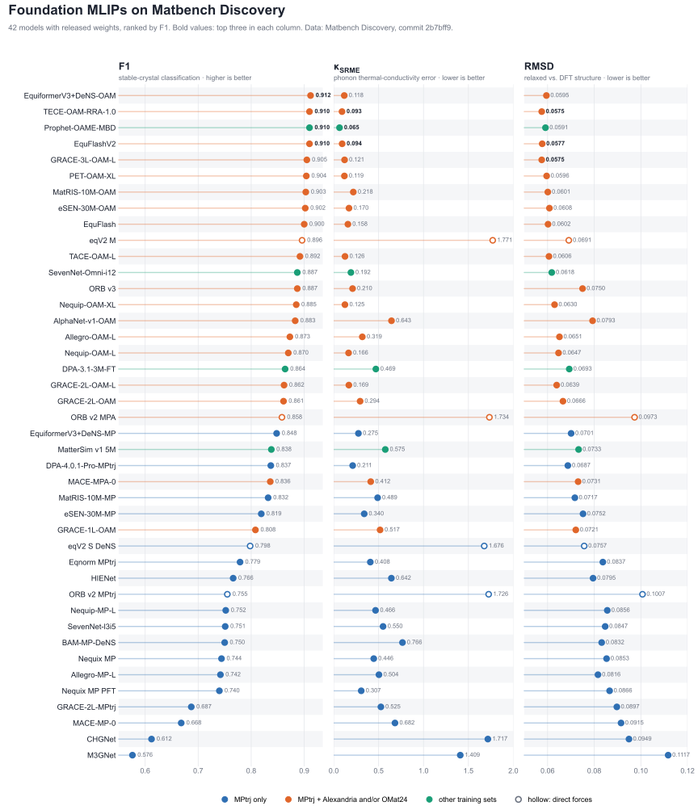
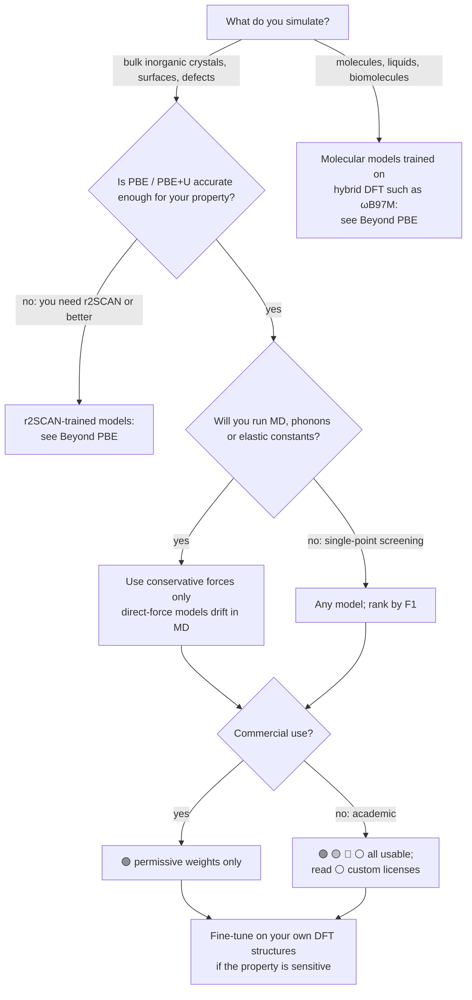

<!-- This file is generated by scripts/build.py from scripts/template.md. Edit those, not this. -->

# Foundation MLIPs: a practical guide

**Which pretrained machine-learned interatomic potential should you use, can you use it, and how do you load it?**

42 foundation models from 23 families with benchmark scores, the data they learned from, force type, weight license and a working ASE snippet for each, on one page. The tables and the figure are rebuilt every week from [Matbench Discovery](https://matbench-discovery.materialsproject.org).

[](https://github.com/NabKh/foundation-mlips/actions/workflows/update.yml)


[](https://github.com/NabKh/foundation-mlips/blob/main/LICENSE)



**Contents:** [Choosing a model](#choosing-a-model) · [Leaderboard](#leaderboard) · [Trends](#trends) · [How to load each model](#how-to-load-each-model) · [Beyond PBE and bulk crystals](#beyond-pbe-and-bulk-crystals) · [Pitfalls](#pitfalls) · [Data sources](#data-sources-and-credit)

## Choosing a model



Three questions sort most choices:

1. **Level of theory.** Almost every model in the leaderboard learned PBE or PBE+U energies; the two marked *Various* use mixed collections that are mostly PBE(+U). A model reproduces its reference, including PBE's errors: band gaps are not predicted, and lattice constants, van der Waals binding and reaction barriers are PBE-quality. If PBE is the wrong reference for your problem, a better potential will not fix it.
2. **Force type.** *Conservative* models get forces as the gradient of the energy, so energy is conserved in MD. *Direct* models predict forces as a separate output; they are faster but do not conserve energy. In the leaderboard below every direct model has a phonon error κ<sub>SRME</sub> above 1.6. Most conservative models are below 0.7; the exceptions are the two oldest, CHGNet and M3GNet.
3. **License.** Code and weights often have different licenses, and the weights decide what you can do with the results. Several of the top models do not allow commercial use.

## Leaderboard

Active models with released weights, sorted by F1. The three best values in each column are in bold. Click a model name for its paper and a star count for its repository.

| Model | Benchmarked | Size | Training data | Forces | F1 ↑ | κ<sub>SRME</sub> ↓ | RMSD ↓ | Weights license | ⭐ |
|---|---|---:|---|---|---:|---:|---:|---|---:|
| [EquiformerV3+DeNS-OAM](https://arxiv.org/abs/2604.09130) | 2026-04 | 30 M | MPtrj, OMat24, sAlex <sub>PBE+U</sub> | conservative | **0.912** | 0.118 | 0.0595 | 🟢 [MIT](https://github.com/atomicarchitects/equiformer_v3) | [127](https://github.com/atomicarchitects/equiformer_v3) |
| [EquFlashV2](https://proceedings.mlr.press/v267/lee25l.html) | 2026-06 | 45 M | MPtrj, OMat24, sAlex <sub>PBE+U</sub> | conservative | **0.910** | **0.094** | **0.0577** | 🔴 [CC-BY-NC-SA-4.0](https://github.com/SamsungDS/GGNN/blob/main/LICENSE.md) [†](#license-corrections) | [21](https://github.com/SamsungDS/GGNN) |
| [Prophet-OAME-MBD](https://www.kairosmaterials.com/papers/Prophet.pdf) | 2026-09 | 62 M | MPtrj, OMat24, sAlex, ELEMENTA <sub>PBE+U</sub> | conservative | **0.910** | **0.065** | 0.0591 | 🟢 [CC-BY-4.0](https://github.com/kairosmaterial/prophet/blob/main/LICENSE-WEIGHTS) | [57](https://github.com/kairosmaterial/prophet) |
| [TECE-OAM-RRA-1.0](https://arxiv.org/abs/2607.10664) | 2026-07 | 222 M | MPtrj, OMat24, sAlex <sub>PBE+U</sub> | conservative | **0.910** | **0.093** | **0.0575** | 🟢 [CC-BY-4.0](https://creativecommons.org/licenses/by/4.0/legalcode) | [73](https://github.com/xvzemin/tace) |
| [GRACE-3L-OAM-L](https://doi.org/10.1038/s41524-026-01979-1) | 2026-07 | 42 M | MPtrj, OMat24, sAlex <sub>PBE+U</sub> | conservative | 0.905 | 0.121 | **0.0575** | 🔴 [ASL](https://github.com/ICAMS/grace-tensorpotential/blob/3f614c8ae6/LICENSE.md) | [106](https://github.com/ICAMS/grace-tensorpotential) |
| [PET-OAM-XL](https://www.nature.com/articles/s41467-025-65662-7) | 2026-01 | 730 M | MPtrj, OMat24, sAlex <sub>PBE+U</sub> | conservative | 0.904 | 0.119 | 0.0596 | 🟢 BSD-3-Clause | [244](https://github.com/lab-cosmo/upet) |
| [MatRIS-10M-OAM](https://arxiv.org/abs/2603.02002) | 2025-10 | 10 M | MPtrj, OMat24, sAlex <sub>PBE+U</sub> | conservative | 0.903 | 0.218 | 0.0601 | 🟢 [BSD-3-Clause](https://github.com/HPC-AI-Team/MatRIS/blob/main/LICENSE) | [45](https://github.com/HPC-AI-Team/MatRIS) |
| [eSEN-30M-OAM](https://arxiv.org/abs/2502.12147) | 2025-03 | 30 M | MPtrj, OMat24, sAlex <sub>PBE+U</sub> | conservative | 0.902 | 0.170 | 0.0608 | ⚪ [Meta Research](https://huggingface.co/facebook/OMAT24/blob/main/LICENSE) | [2,297](https://github.com/FAIR-Chem/fairchem) |
| [EquFlash](https://proceedings.mlr.press/v267/lee25l.html) | 2025-06 | 29 M | MPtrj, OMat24, sAlex <sub>PBE+U</sub> | conservative | 0.900 | 0.158 | 0.0602 | 🔴 [CC-BY-NC-SA-4.0](https://github.com/SamsungDS/GGNN/blob/main/LICENSE.md) [†](#license-corrections) | [21](https://github.com/SamsungDS/GGNN) |
| [eqV2 M](https://arxiv.org/abs/2410.12771) | 2024-10 | 87 M | MPtrj, OMat24 <sub>PBE+U</sub> | **direct** | 0.896 | 1.771 | 0.0691 | ⚪ [Meta Research](https://huggingface.co/facebook/OMAT24/blob/main/LICENSE) | [2,297](https://github.com/FAIR-Chem/fairchem) |
| [TACE-OAM-L](https://arxiv.org/abs/2509.14961) | 2026-04 | 83 M | MPtrj, OMat24, sAlex <sub>PBE+U</sub> | conservative | 0.892 | 0.126 | 0.0606 | 🟢 [CC-BY-4.0](https://creativecommons.org/licenses/by/4.0/legalcode) | [73](https://github.com/xvzemin/tace) |
| [ORB v3](https://arxiv.org/abs/2504.06231) | 2025-04 | 26 M | MPtrj, Alex, OMat24 <sub>PBE / PBE+U</sub> | conservative | 0.887 | 0.210 | 0.0750 | 🟢 [Apache-2.0](https://github.com/orbital-materials/orb-models/blob/3e9580809/LICENSE) | [623](https://github.com/orbital-materials/orb-models) |
| [SevenNet-Omni-i12](https://arxiv.org/abs/2510.11241) | 2026-01 | 55 M | COSMOSDataset <sub>Various</sub> | conservative | 0.887 | 0.192 | 0.0618 | 🟢 [MIT](https://github.com/MDIL-SNU/SevenNet/blob/main/LICENSE) | [277](https://github.com/MDIL-SNU/SevenNet) |
| [Nequip-OAM-XL](https://arxiv.org/abs/2504.16068) | 2025-11 | 32 M | MPtrj, OMat24, sAlex <sub>PBE+U</sub> | conservative | 0.885 | 0.125 | 0.0630 | 🟢 [CC-BY-4.0](https://creativecommons.org/licenses/by/4.0/legalcode) | [970](https://github.com/mir-group/nequip) |
| [AlphaNet-v1-OAM](https://arxiv.org/abs/2501.07155) | 2025-05 | 4.7 M | MPtrj, OMat24, sAlex <sub>PBE+U</sub> | conservative | 0.883 | 0.643 | 0.0793 | 🟡 [GPL-3.0](https://github.com/zmyybc/AlphaNet/blob/main/LICENSE) | [122](https://github.com/zmyybc/AlphaNet) |
| [Allegro-OAM-L](https://arxiv.org/abs/2504.16068) | 2025-09 | 9.7 M | MPtrj, OMat24, sAlex <sub>PBE+U</sub> | conservative | 0.873 | 0.319 | 0.0651 | 🟢 [CC-BY-4.0](https://creativecommons.org/licenses/by/4.0/legalcode) | [505](https://github.com/mir-group/allegro) |
| [Nequip-OAM-L](https://arxiv.org/abs/2504.16068) | 2025-09 | 9.6 M | MPtrj, OMat24, sAlex <sub>PBE+U</sub> | conservative | 0.870 | 0.166 | 0.0647 | 🟢 [CC-BY-4.0](https://creativecommons.org/licenses/by/4.0/legalcode) | [970](https://github.com/mir-group/nequip) |
| [DPA-3.1-3M-FT](https://arxiv.org/abs/2506.01686) | 2025-06 | 3.3 M | OpenLAM <sub>Various</sub> | conservative | 0.864 | 0.469 | 0.0693 | 🟡 [LGPL-3.0](https://github.com/deepmodeling/deepmd-kit/blob/70bc6d89/LICENSE) | [2,062](https://github.com/deepmodeling/deepmd-kit) |
| [GRACE-2L-OAM-L](https://arxiv.org/abs/2508.17936) | 2025-09 | 26 M | MPtrj, OMat24, sAlex <sub>PBE+U</sub> | conservative | 0.862 | 0.169 | 0.0639 | 🔴 [ASL](https://github.com/ICAMS/grace-tensorpotential/blob/3f614c8ae6/LICENSE.md) | [106](https://github.com/ICAMS/grace-tensorpotential) |
| [GRACE-2L-OAM](https://journals.aps.org/prx/abstract/10.1103/PhysRevX.14.021036) | 2025-02 | 13 M | MPtrj, OMat24, sAlex <sub>PBE+U</sub> | conservative | 0.861 | 0.294 | 0.0666 | 🔴 [ASL](https://github.com/ICAMS/grace-tensorpotential/blob/3f614c8ae6/LICENSE.md) | [106](https://github.com/ICAMS/grace-tensorpotential) |
| [ORB v2 MPA](https://arxiv.org/abs/2410.22570) | 2024-10 | 25 M | MPtrj, Alex <sub>PBE / PBE+U</sub> | **direct** | 0.858 | 1.734 | 0.0973 | 🟢 [Apache-2.0](https://github.com/orbital-materials/orb-models/blob/637a98d49/LICENSE) | [623](https://github.com/orbital-materials/orb-models) |
| [EquiformerV3+DeNS-MP](https://arxiv.org/abs/2604.09130) | 2026-04 | 30 M | MPtrj <sub>PBE+U</sub> | conservative | 0.848 | 0.275 | 0.0701 | 🟢 [MIT](https://github.com/atomicarchitects/equiformer_v3) | [127](https://github.com/atomicarchitects/equiformer_v3) |
| [MatterSim v1 5M](https://arxiv.org/abs/2405.04967) | 2024-12 | 4.5 M | MatterSim <sub>PBE+U</sub> | conservative | 0.838 | 0.575 | 0.0733 | 🟢 [MIT](https://github.com/microsoft/mattersim/blob/d0a52e64fc/MODEL_CARD.md) | [605](https://github.com/microsoft/mattersim) |
| [DPA-4.0.1-Pro-MPtrj](https://arxiv.org/abs/2606.02419) | 2026-06 | 23 M | MPtrj <sub>PBE+U</sub> | conservative | 0.837 | 0.211 | 0.0687 | 🟢 [CC-BY-4.0](https://creativecommons.org/licenses/by/4.0/legalcode) | [2,062](https://github.com/deepmodeling/deepmd-kit) |
| [MACE-MPA-0](https://arxiv.org/abs/2401.00096) | 2024-12 | 9.1 M | MPtrj, sAlex <sub>PBE+U</sub> | conservative | 0.836 | 0.412 | 0.0731 | 🟢 [MIT](https://github.com/ACEsuit/mace-foundations/blob/1ff8786eb/LICENSE) | [1,392](https://github.com/ACEsuit/mace) |
| [MatRIS-10M-MP](https://arxiv.org/abs/2603.02002) | 2025-10 | 10 M | MPtrj <sub>PBE+U</sub> | conservative | 0.832 | 0.489 | 0.0717 | 🟢 [BSD-3-Clause](https://github.com/HPC-AI-Team/MatRIS/blob/main/LICENSE) | [45](https://github.com/HPC-AI-Team/MatRIS) |
| [eSEN-30M-MP](https://arxiv.org/abs/2502.12147) | 2025-03 | 30 M | MPtrj <sub>PBE+U</sub> | conservative | 0.819 | 0.340 | 0.0752 | ⚪ [Meta Research](https://huggingface.co/facebook/OMAT24/blob/main/LICENSE) | [2,297](https://github.com/FAIR-Chem/fairchem) |
| [GRACE-1L-OAM](https://journals.aps.org/prx/abstract/10.1103/PhysRevX.14.021036) | 2025-02 | 3.4 M | MPtrj, OMat24, sAlex <sub>PBE+U</sub> | conservative | 0.808 | 0.517 | 0.0721 | 🔴 [ASL](https://github.com/ICAMS/grace-tensorpotential/blob/3f614c8ae6/LICENSE.md) | [106](https://github.com/ICAMS/grace-tensorpotential) |
| [eqV2 S DeNS](https://arxiv.org/abs/2410.12771) | 2024-10 | 31 M | MPtrj <sub>PBE+U</sub> | **direct** | 0.798 | 1.676 | 0.0757 | ⚪ [Meta Research](https://huggingface.co/facebook/OMAT24/blob/main/LICENSE) | [2,297](https://github.com/FAIR-Chem/fairchem) |
| Eqnorm MPtrj | 2025-05 | 1.3 M | MPtrj <sub>PBE+U</sub> | conservative | 0.779 | 0.408 | 0.0837 | 🟢 [MIT](https://github.com/yzchen08/eqnorm/blob/main/LICENSE) | [14](https://github.com/yzchen08/eqnorm) |
| [HIENet](https://arxiv.org/pdf/2503.05771) | 2025-07 | 7.5 M | MPtrj <sub>PBE+U</sub> | conservative | 0.766 | 0.642 | 0.0795 | 🟡 [GPL-3.0](https://github.com/divelab/AIRS/blob/main/OpenMat/HIENet/LICENSE) | [803](https://github.com/divelab/AIRS/tree/main/OpenMat/HIENet) |
| [ORB v2 MPtrj](https://arxiv.org/abs/2410.22570) | 2024-10 | 25 M | MPtrj <sub>PBE+U</sub> | **direct** | 0.755 | 1.726 | 0.1007 | 🟢 [Apache-2.0](https://github.com/orbital-materials/orb-models/blob/637a98d49/LICENSE) | [623](https://github.com/orbital-materials/orb-models) |
| [Nequip-MP-L](https://arxiv.org/abs/2504.16068) | 2025-09 | 9.6 M | MPtrj <sub>PBE+U</sub> | conservative | 0.752 | 0.466 | 0.0856 | 🟢 [CC-BY-4.0](https://creativecommons.org/licenses/by/4.0/legalcode) | [970](https://github.com/mir-group/nequip) |
| [SevenNet-l3i5](https://arxiv.org/abs/2402.03789) | 2024-12 | 1.2 M | MPtrj <sub>PBE+U</sub> | conservative | 0.751 | 0.550 | 0.0847 | 🟡 [GPL-3.0](https://github.com/MDIL-SNU/SevenNet/blob/8ce2c9d4/LICENSE) | [277](https://github.com/MDIL-SNU/SevenNet) |
| BAM-MP-DeNS | 2026-10 | 6.5 M | MPtrj <sub>PBE+U</sub> | conservative | 0.750 | 0.766 | 0.0832 | 🟢 [MIT](https://github.com/myung-group/BAM-torch/blob/BAM_DeNS/LICENSE) | [6](https://github.com/myung-group/BAM-torch) |
| [Nequix MP](https://arxiv.org/abs/2508.16067) | 2025-08 | 0.7 M | MPtrj <sub>PBE+U</sub> | conservative | 0.744 | 0.446 | 0.0853 | 🟢 [CC-BY-4.0](https://creativecommons.org/licenses/by/4.0/) | [80](https://github.com/atomicarchitects/nequix) |
| [Allegro-MP-L](https://arxiv.org/abs/2504.16068) | 2025-09 | 19 M | MPtrj <sub>PBE+U</sub> | conservative | 0.742 | 0.504 | 0.0816 | 🟢 [CC-BY-4.0](https://creativecommons.org/licenses/by/4.0/legalcode) | [505](https://github.com/mir-group/allegro) |
| [Nequix MP PFT](https://arxiv.org/abs/2601.07742) | 2026-01 | 0.7 M | MPtrj, MDR-MP PBE ω_q <sub>PBE+U</sub> | conservative | 0.740 | 0.307 | 0.0866 | 🟢 [CC-BY-4.0](https://creativecommons.org/licenses/by/4.0/) | [80](https://github.com/atomicarchitects/nequix) |
| [GRACE-2L-MPtrj](https://journals.aps.org/prx/abstract/10.1103/PhysRevX.14.021036) | 2024-11 | 15 M | MPtrj <sub>PBE+U</sub> | conservative | 0.687 | 0.525 | 0.0897 | 🔴 [ASL](https://github.com/ICAMS/grace-tensorpotential/blob/3f614c8ae6/LICENSE.md) | [106](https://github.com/ICAMS/grace-tensorpotential) |
| [MACE-MP-0](https://arxiv.org/abs/2401.00096) | 2023-07 | 4.7 M | MPtrj <sub>PBE+U</sub> | conservative | 0.668 | 0.682 | 0.0915 | 🟢 [MIT](https://github.com/ACEsuit/mace-foundations/blob/1ff8786eb/LICENSE) | [1,392](https://github.com/ACEsuit/mace) |
| [CHGNet](https://arxiv.org/abs/2302.14231) | 2023-03 | 0.4 M | MPtrj <sub>PBE+U</sub> | conservative | 0.612 | 1.717 | 0.0949 | 🟢 [BSD-3-Clause](https://github.com/CederGroupHub/chgnet/blob/d55f185199f/LICENSE) | [414](https://github.com/CederGroupHub/chgnet) |
| [M3GNet](https://arxiv.org/abs/2202.02450) | 2022-09 | 0.2 M | MPF <sub>PBE+U</sub> | conservative | 0.576 | 1.409 | 0.1117 | 🟢 [MIT](https://github.com/materialsvirtuallab/m3gnet/blob/3a8b14dfd59/LICENSE) | [332](https://github.com/materialsvirtuallab/m3gnet) |

**Columns**

- **Benchmarked**: the month the model was added to Matbench Discovery.
- **Training data**: the datasets, with their DFT level of theory underneath (from Matbench Discovery `data/datasets.yml`). *Various* means a mix of codes and functionals.
- **Forces**: *conservative* means forces are −∂E/∂r; **direct** means forces are a separate output.
- **F1 ↑**: harmonic mean of precision and recall for classifying the 257k WBM crystals as stable or unstable (energy above the MP convex hull ≤ 0). Range 0 to 1.
- **κ<sub>SRME</sub> ↓**: symmetric relative mean error of the phonon contributions to lattice thermal conductivity, averaged over 103 PhononDB-PBE materials. Range 0 to 2; it needs accurate second and third derivatives of the energy.
- **RMSD ↓**: normalised, unitless StructureMatcher RMSD between the ML-relaxed and the DFT-relaxed structure. Unmatched structures count as 1.0.
- **Weights license**: 🟢 permissive (MIT, BSD, Apache, CC-BY) · 🟡 copyleft (GPL, LGPL): share changes under the same license · 🔴 academic / non-commercial use only · ⚪ custom license: read it before use

#### License corrections

Where a model's own repository disagrees with the license Matbench Discovery lists, this table uses the repository:

- EquFlash, EquFlashV2: Matbench Discovery lists CC-BY-4.0; the repository LICENSE.md says CC BY-NC-SA 4.0. [Source](https://github.com/SamsungDS/GGNN/blob/main/LICENSE.md).

## Trends

Most of the gain since 2024 comes from training data. Every model trained only on MPtrj (1.58 M structures) scores F1 below 0.85. Models that add OMat24 and sAlex, much larger sets with many off-equilibrium structures, score 0.81 to 0.91 and fill the top ten.

Among the models trained on MPtrj + OMat24 + sAlex, every one above 10 M parameters scores F1 0.86 to 0.91, whether it has 10 M (MatRIS) or 730 M (PET-OAM-XL) parameters: the training data matter more than the size.

Almost every training set is PBE or PBE+U, as recorded in Matbench Discovery's dataset list.

## How to load each model

Every snippet below comes from the model's own README or documentation, linked under each one, and returns an ASE calculator. Run it in a clean environment per family, because the PyTorch, e3nn and JAX pins often conflict.

```python
from ase.build import bulk
from ase.filters import FrechetCellFilter
from ase.optimize import FIRE

atoms = bulk("Cu", "fcc", a=3.6, cubic=True)
atoms.calc = calc  # any calculator below
FIRE(FrechetCellFilter(atoms)).run(fmax=0.02)
print(atoms.get_potential_energy(), atoms.cell.lengths())
```

<details>
<summary><b>MACE</b> · MACE-MPA-0, MACE-MP-0 (also MACE-OMAT-0, MACE-MATPES)</summary>

```bash
pip install mace-torch
```

```python
from mace.calculators import mace_mp

# "medium-mpa-0"; "small" / "medium" / "large" for MACE-MP-0; "medium-omat-0"
calc = mace_mp(model="medium-mpa-0", default_dtype="float64", device="cpu")  # float32 for MD
```

`mace_mp(dispersion=True)` adds D3. MACE-MP energies are raw MPtrj VASP energies, without MP2020 corrections. MACE-OMAT-0 and the MATPES models are under the Academic Software License (non-commercial). Tested here with mace-torch 0.3.14 (Cu fcc relaxes to a = 3.638 Å).

Source: [MACE README, MACE-MP](https://github.com/ACEsuit/mace#readme)
</details>

<details>
<summary><b>CHGNet</b> · CHGNet 0.3.0</summary>

```bash
pip install chgnet
```

```python
from chgnet.model.dynamics import CHGNetCalculator

calc = CHGNetCalculator(use_device="cpu")  # loads the pretrained 0.3.0 model; "cuda" on GPU
```

Also `CHGNet.load("r2scan")`. CHGNet predicts magnetic moments and its energies include MP2020 corrections. On Apple Silicon pass `use_device="cpu"`; MPS does not support float64. Tested here with chgnet 0.4.0 (Cu fcc relaxes to a = 3.619 Å).

Source: [CHGNet API docs, chgnet.model.dynamics](https://chgnet.lbl.gov/api)
</details>

<details>
<summary><b>matgl (M3GNet, TensorNet, CHGNet on MatPES)</b> · M3GNet, MatPES PBE and r2SCAN models</summary>

```bash
pip install matgl
```

```python
import matgl
from matgl.ext.ase import PESCalculator

pot = matgl.load_model("TensorNet-PES-MatPES-PBE-2025.2")  # or ...-MatPES-r2SCAN-2025.2
calc = PESCalculator(potential=pot, stress_unit="eV/A3")
```

Models now come only from the `materialyze` Hugging Face organisation; the original M3GNet-MP-2021.2.8-PES benchmarked here is not listed there. matgl 3.0 fixed a message-passing bug that makes older weights numerically invalid; run `mgl clear` after upgrading.

Source: [matgl README and tutorials](https://github.com/materialyzeai/matgl#readme)
</details>

<details>
<summary><b>SevenNet</b> · SevenNet-Omni, SevenNet-l3i5</summary>

```bash
pip install sevenn
```

```python
from sevenn.calculator import SevenNetCalculator

calc = SevenNetCalculator(model="7net-omni", modal="mpa")  # modal: mpa, omat24, matpes_r2scan, omol25_high, ...
# calc = SevenNetCalculator("7net-l3i5")                   # single-task model, no modal
```

`modal` is required for multi-fidelity models and picks the level of theory. `SevenNetD3Calculator` adds D3(BJ) on CUDA GPUs only.

Source: [SevenNet docs, ASE calculator](https://github.com/MDIL-SNU/SevenNet#readme)
</details>

<details>
<summary><b>Orb</b> · Orb v3, Orb v2</summary>

```bash
pip install orb-models
```

```python
from orb_models.forcefield import pretrained
from orb_models.forcefield.inference.calculator import ORBCalculator

orbff, atoms_adapter = pretrained.orb_v3_conservative_inf_omat(device="cpu", precision="float32-high")
calc = ORBCalculator(orbff, atoms_adapter=atoms_adapter, device="cpu")  # or "cuda"
```

Use `precision="float32-highest"` for phonons and other second derivatives. `-20` models cap neighbours at 20, which makes the energy surface discontinuous. Orb v2 has direct forces; the `conservative` v3 models do not. The first call is slow because the model is compiled. macOS and Linux only.

Source: [orb-models README, ASE calculator](https://github.com/orbital-materials/orb-models#readme)
</details>

<details>
<summary><b>MatterSim</b> · MatterSim v1 5M</summary>

```bash
pip install mattersim
```

```python
import torch
from mattersim.forcefield import MatterSimCalculator

device = "cuda" if torch.cuda.is_available() else "cpu"
calc = MatterSimCalculator(load_path="MatterSim-v1.0.0-5M.pth", device=device)  # 1M model if omitted
```

Needs Python >= 3.12. On Apple Silicon use CPU; the README reports MPS is numerically unstable. Trained for bulk materials.

Source: [MatterSim README, Usage](https://github.com/microsoft/mattersim#readme)
</details>

<details>
<summary><b>GRACE</b> · GRACE-3L-OAM-L, GRACE-2L-OAM, GRACE-1L-OAM, GRACE-2L-MPtrj</summary>

```bash
pip install tensorpotential
```

```python
from tensorpotential.calculator import grace_fm

calc = grace_fm("GRACE-2L-OMAT-large-ft-AM")  # full names only; see the foundation-model list
```

The code is under the Academic Software License (non-commercial). Medium and large 1L/2L models have a `-fp64` variant for tight finite differences such as phonons; 3L models are fp32 only. `grace_fm` needs the full model name; short aliases work only in `grace_models`.

Source: [GRACE docs, foundation models](https://gracemaker.readthedocs.io/en/latest/gracemaker/foundation/)
</details>

<details>
<summary><b>fairchem (eSEN, eqV2, UMA)</b> · eSEN-30M-OAM, eSEN-30M-MP, eqV2 M/S</summary>

```bash
pip install fairchem-core
```

```python
from fairchem.core import FAIRChemCalculator, pretrained_mlip

predictor = pretrained_mlip.get_predict_unit("uma-s-1p2p1", device="cuda")
calc = FAIRChemCalculator(predictor, task_name="omat")  # tasks: omat, omol, oc20, odac, omc, ...
```

Weights are gated: request access on Hugging Face (huggingface.co/facebook/UMA) and run `huggingface-cli login` first. fairchem v2 cannot load the eqV2 OMat24 checkpoints benchmarked here; those need `pip install fairchem-core==1.10`. OMat24 and UMA energies are not on the Materials Project scale: do not apply MP2020 corrections to them.

Source: [fairchem README](https://github.com/facebookresearch/fairchem#readme)
</details>

<details>
<summary><b>NequIP / Allegro</b> · NequIP-OAM-XL, NequIP-OAM-L, Allegro-OAM-L, NequIP-MP-L, Allegro-MP-L</summary>

```bash
pip install nequip nequip-allegro
```

```python
# compile once, on the device you will run on:
#   nequip-compile nequip.net:mir-group/NequIP-OAM-L:0.1 model.nequip.pt2 \
#     --device cuda --mode aotinductor --target ase
from nequip.integrations.ase import NequIPCalculator

calc = NequIPCalculator.from_compiled_model(compile_path="model.nequip.pt2", device="cuda")
```

AOTInductor compilation needs PyTorch >= 2.6. For Allegro models add `--modifiers enable_TritonContracter` or `enable_CuEquivarianceContracter` (not both).

Source: [NequIP docs, foundation potentials](https://nequip.readthedocs.io/en/latest/guide/getting-started/foundation_potentials.html)
</details>

<details>
<summary><b>DeePMD-kit (DPA)</b> · DPA-3.1-3M, DPA-4.0.1</summary>

```bash
pip install "deepmd-kit[torch]"
```

```python
from deepmd.calculator import DP

# multi-head models: freeze one head first, e.g. dp --pt freeze --model-branch <head>
calc = DP(model="frozen_model.pth")
```

`deepmd.infer.DeepPot("DPA-3.1-3M")` downloads a built-in model by name. The DPA4-OMat24 weights on Hugging Face are CC-BY-NC-4.0 (non-commercial); the MPtrj DPA-4 checkpoint in the leaderboard is listed as CC-BY-4.0.

Source: [DeePMD-kit docs, ASE](https://docs.deepmodeling.com/projects/deepmd/en/latest/third-party/ase.html)
</details>

<details>
<summary><b>UPET (PET-OAM, PET-MAD)</b> · PET-OAM-XL</summary>

```bash
pip install upet
```

```python
from upet.ase import UPETCalculator

calc = UPETCalculator(model="pet-oam-xl", device="cuda")             # PBE, materials discovery
# calc = UPETCalculator(model="pet-mad-s", version="1.6.0", device="cpu")  # r2SCAN, MD
```

Forces are conservative by default; `non_conservative=True` is 2-3x faster but needs care in MD. The docs recommend PET-OAM for convex hulls, relaxations and phonons, and PET-MAD for MD.

Source: [UPET README, Quick start](https://github.com/lab-cosmo/upet#readme)
</details>

<details>
<summary><b>MatRIS</b> · MatRIS-10M-OAM, MatRIS-10M-MP</summary>

```bash
# README lists the requirements only: Python >= 3.12, PyTorch >= 2.11, ASE, pymatgen, nvalchemi-toolkit-ops
git clone https://github.com/HPC-AI-Team/MatRIS && pip install -e MatRIS
```

```python
from matris.applications.base import MatRISCalculator

calc = MatRISCalculator(model="matris_10m_oam", task="efsm", device="cuda",
                        mode="fast", activation_checkpoint=True, tf32=False)  # or "matris_10m_mp"
```

`mode="fast"` uses optimised kernels and compilation; `mode="torch"` runs plain eager PyTorch. Task `efsm` also returns magnetic moments.

Source: [MatRIS README, Usage](https://github.com/HPC-AI-Team/MatRIS#readme)
</details>

<details>
<summary><b>TACE / TECE</b> · TECE-OAM-RRA-1.0, TACE-OAM-L</summary>

```bash
pip install tace
```

```python
import torch
from tace.interface.ase import TACEAseCalc

calc = TACEAseCalc(model="TACE-OAM-L", dtype="float32", fidelity_idx=0,  # or "TECE-OAM-RRA-1.0"
                   device="cuda" if torch.cuda.is_available() else "cpu")
```

Model names must match the registry exactly, including suffixes such as `-1.0`. Weights are cached in `~/.cache/tace/`. Needs TACE >= 0.2.0.

Source: [TACE docs, foundation models](https://tace.readthedocs.io/en/latest/guide/foundation.html)
</details>

<details>
<summary><b>Prophet</b> · Prophet-OAME-MBD</summary>

```bash
pip install "prophet-mlip @ git+https://github.com/kairosmaterial/prophet.git"
```

```python
from prophet import KairosCalculator

# weights: https://huggingface.co/kairosmaterial/prophet
calc = KairosCalculator(model_path="prophet-oame-mbd.pt", use_kernel=False, device="cpu")
```

Released as a research preview. `use_kernel=False` runs pure e3nn and works on CPU; `prophet-mlip[kernel]` adds CUDA kernels (needs nvcc).

Source: [Prophet README, Quick start](https://github.com/kairosmaterial/prophet#readme)
</details>

<details>
<summary><b>EquFlash</b> · EquFlashV2, EquFlash</summary>

```bash
git clone https://github.com/SamsungDS/GGNN && cd GGNN
pip install -r requirements.txt && pip install --no-deps -r requirements-no-deps.txt
```

```python
from GGNN.common.calculator import UCalculator

# equflashv2-OAM: https://figshare.com/ndownloader/files/65435007
# equflash-OAM:   https://figshare.com/ndownloader/files/65435004
calc = UCalculator(checkpoint_path="checkpoint.pt", cpu=False)
```

Pinned to Python 3.12, PyTorch 2.9.1 (CUDA 12.6) and `fairchem.core==1.10.0`. The repository license is CC BY-NC-SA 4.0 (non-commercial).

Source: [GGNN README, Calculator](https://github.com/SamsungDS/GGNN#readme)
</details>

<details>
<summary><b>AlphaNet</b> · AlphaNet-v1-OAM</summary>

```bash
git clone https://github.com/zmyybc/AlphaNet && cd AlphaNet
pip install -r requirements.txt && pip install -e .
```

```python
from alphanet.config import All_Config
from alphanet.infer.calc import AlphaNetCalculator

# state_dict: https://ndownloader.figshare.com/files/53851139 (see pretrained/OMA/README.md)
calc = AlphaNetCalculator(ckpt_path="./alex_0410.ckpt", device="cuda", precision="32",
                          config=All_Config().from_json("./pretrained/OMA/oma.json"))
```

PyTorch and JAX backends (JAX: `from alphanet.infer.new_haiku import AlphaNetCalculator`). The JAX model compiles on the first call.

Source: [AlphaNet README, Quick Start](https://github.com/zmyybc/AlphaNet#readme)
</details>

<details>
<summary><b>Nequix</b> · Nequix-MP-1</summary>

```bash
pip install nequix
```

```python
from nequix.calculator import NequixCalculator

calc = NequixCalculator("nequix-mp-1", backend="jax")  # or backend="torch"
```

JAX is the default backend; analytical Hessians are JAX-only.

Source: [Nequix README, ASE calculator](https://github.com/atomicarchitects/nequix#readme)
</details>

<details>
<summary><b>Eqnorm</b> · Eqnorm MPtrj</summary>

```bash
pip install git+https://github.com/yzchen08/eqnorm.git
```

```python
from eqnorm.calculator import EqnormCalculator

calc = EqnormCalculator(model_name="eqnorm", model_variant="eqnorm-mptrj", device="cuda")
```

Requires Python >= 3.10. Only `eqnorm-mptrj` is available.

Source: [Eqnorm README, Usage](https://github.com/yzchen08/eqnorm#readme)
</details>

<details>
<summary><b>HIENet</b> · HIENet</summary>

```bash
git clone https://github.com/divelab/AIRS && pip install AIRS/OpenMat/HIENet
```

```python
from hienet.hienet_calculator import HIENetCalculator

calc = HIENetCalculator()  # pretrained model; or HIENetCalculator(model="ckpt.pth", device="cuda:0")
```

GPL-3.0, built on SevenNet.

Source: [HIENet README, ASE Calculator](https://github.com/divelab/AIRS/tree/main/OpenMat/HIENet#readme)
</details>

<details>
<summary><b>EquiformerV3</b> · EquiformerV3 (MP, OAM)</summary>

```bash
# environment: experimental/docs/env_setup.md (torch 2.7.1 + cu128, bundled fairchem-core fork)
git clone https://github.com/atomicarchitects/equiformer_v3 && pip install -e equiformer_v3/packages/fairchem-core
```

```python
from fairchem.core import OCPCalculator

# checkpoints: https://huggingface.co/mirror-physics/equiformer_v3
#   checkpoint/omat24-mptrj-salex_gradient.pt (OAM), checkpoint/mptrj_gradient.pt (MP)
calc = OCPCalculator(checkpoint_path="omat24-mptrj-salex_gradient.pt", cpu=False, seed=0)
```

The README does not document an ASE calculator. This is how the repository's own Matbench Discovery script loads the model (`experimental/tasks/matbench_discovery/test_discovery.py`).

Source: [EquiformerV3 benchmark script](https://github.com/atomicarchitects/equiformer_v3/blob/main/experimental/tasks/matbench_discovery/test_discovery.py)
</details>

<details>
<summary><b>BAM</b> · BAM-MP-DeNS</summary>

```bash
git clone https://github.com/myung-group/BAM-torch && pip install -e BAM-torch
```

No documented ASE calculator and no public checkpoint: the example README says "Checkpoints and training datasets are supplied separately."

Source: [BAM-torch example README](https://github.com/myung-group/BAM-torch/tree/main/examples/bam-mp-dens)
</details>

## Beyond PBE and bulk crystals

Matbench Discovery tests only PBE-level inorganic crystals. The models below are trained on other levels of theory or other chemistry, so they are not in the leaderboard and their scores cannot be compared with it.

| Model | Domain | Reference level of theory | Training data | Weights license | Paper |
|---|---|---|---|---|---|
| [MatPES models (TensorNet, M3GNet, CHGNet, QET)](https://github.com/materialyzeai/matgl) | bulk inorganic | PBE and r2SCAN, no +U | MatPES, 434,712 PBE and 387,897 r2SCAN calculations | ⚪ not stated on the model cards (code BSD-3-Clause) | [arXiv:2503.04070](https://arxiv.org/abs/2503.04070) |
| [MACE-MATPES-PBE-0 / -r2SCAN-0](https://github.com/ACEsuit/mace-foundations) | bulk inorganic, 89 elements | PBE (no +U) or r2SCAN | MatPES, fine-tuned from MACE-OMAT-0 | 🔴 ASL | [arXiv:2503.04070 (data)](https://arxiv.org/abs/2503.04070) |
| [UMA](https://github.com/facebookresearch/fairchem) | all-purpose, one task head per domain | PBE(+U) (omat), ωB97M-V/def2-TZVPD (omol), RPBE (oc20), PBE+D3 (omc, odac) | OMat24, OMol25, OC20, OMC25, ODAC25 | ⚪ [FAIR Chemistry License, gated](https://huggingface.co/facebook/UMA) | [arXiv:2506.23971](https://arxiv.org/abs/2506.23971) |
| [MACE-MH-1](https://huggingface.co/mace-foundations/mace-mh-1) | all-purpose, multi-head, 89 elements | PBE(+U), r2SCAN, ωB97M-V, ωB97M-D3(BJ), B3LYP (one head each) | OMat24 pre-training, then OMol25 subset, SPICE, RGD1, OC20, MatPES | 🔴 ASL | [arXiv:2510.25380](https://arxiv.org/abs/2510.25380) |
| [DPA-3.1-3M](https://github.com/deepmodeling/deepmd-kit) | all-purpose, multi-head | PBE(+U), PBEsol, SCAN, RPBE, ωB97M-D3(BJ), ωB97X and others (one head per dataset) | OpenLAM collection | 🟢 [CC-BY-4.0](https://huggingface.co/deepmodelingcommunity/DPA-3.1-3M) | [npj Comput. Mater. (2026)](https://doi.org/10.1038/s41524-026-02146-2) |
| [PET-MAD (UPET)](https://github.com/lab-cosmo/upet) | all-purpose (bulk, surfaces, clusters, molecules) | PBEsol without spin (v1.0); r2SCAN (v1.5 and later) | MAD, 95,595 structures, 85 elements (v1.0) | 🟢 BSD-3-Clause | [Nat. Commun. (2025)](https://doi.org/10.1038/s41467-025-65662-7) |
| [MACE-OFF23 / OFF24](https://github.com/ACEsuit/mace-off) | neutral organic molecules, 10 elements, short-range | ωB97M-D3(BJ)/def2-TZVPPD | SPICE (neutral subset) | 🔴 ASL | [JACS (2025)](https://doi.org/10.1021/jacs.4c07099) |
| [MACE-OMOL-0](https://github.com/ACEsuit/mace-foundations) | molecules with charge and spin, 83 elements | ωB97M-V/def2-TZVPD | OMol25 (100 M) | 🔴 ASL | [release note](https://github.com/ACEsuit/mace-foundations/releases/tag/mace_omol_0) |
| [AIMNet2](https://github.com/isayevlab/aimnetcentral) | neutral and charged molecules, 14 elements | ωB97M-D3(BJ), dispersion added by the calculator | see paper | 🟢 MIT | [Chem. Sci. (2025)](https://doi.org/10.1039/D4SC08572H) |
| [Egret-1](https://github.com/rowansci/egret-public) | bioorganic and main-group molecules | ωB97M-D3(BJ)/def2-TZVPPD | see paper | 🟢 MIT | [arXiv:2504.20955](https://arxiv.org/abs/2504.20955) |
| [SO3LR](https://github.com/general-molecular-simulations/so3lr) | drug-like molecules, protein fragments, dimers; long-range terms built in | PBE0+MBD | GEMS, QM7-X, AQM, SPICE dipeptides, DES15k | 🟢 MIT | [JACS (2025)](https://doi.org/10.1021/jacs.5c09558) |

## Pitfalls

1. **Energies are on different scales.** A model reproduces the energy reference of its training data, and those differ. MACE-MP models learned raw MPtrj VASP energies, without MP2020 corrections ([MACE README](https://github.com/ACEsuit/mace#pretrained-foundation-models)). CHGNet energies include the MP2020 corrections. Models trained on OMat24 use different DFT(+U) settings and are not compatible with Materials Project energies: do not apply MP2020 corrections to them or mix them with MP reference compounds ([fairchem README](https://github.com/facebookresearch/fairchem#readme)). Build convex hulls and reaction energies from one model, or check which reference the model uses before mixing in DFT values.
2. **Systematic softening.** M3GNet, CHGNet and MACE-MP-0 underestimate the curvature of the energy surface, because their training data are mostly near equilibrium: surface, defect and solid-solution energies, phonon frequencies and migration barriers come out too low. Fine-tuning on very little data corrects most of it; the authors show it with a single extra structure ([Deng et al., arXiv:2405.07105](https://arxiv.org/abs/2405.07105)).
3. **Direct forces in MD.** A direct-force model does not conserve energy, so an NVE run drifts and NVT hides the drift in the thermostat. Check the energy drift in a short NVE run before trusting any production MD.
4. **Benchmark scope.** F1 is measured on WBM, a set of bulk inorganic crystals. It says little about surfaces, interfaces, amorphous phases, liquids, molecules or high-pressure phases ([Riebesell et al., arXiv:2308.14920](https://arxiv.org/abs/2308.14920)).
5. **Magnetism and charge.** Unless a model's documentation says otherwise, assume it has no spin or charge input. It then learns whatever magnetic state the training DFT converged to, and cannot tell apart two magnetic orderings or two charge states of the same structure.
6. **Name the exact checkpoint.** Scores here are for the checkpoint Matbench Discovery tested, linked from each model's [`models/*.yml`](https://github.com/janosh/matbench-discovery/tree/main/models) file. Families ship several checkpoints with different scores, so report the file name in your paper.

## Data sources and credit

- Benchmark metrics, model metadata, training sets and licenses: [Matbench Discovery](https://github.com/janosh/matbench-discovery) (MIT), commit [`2b7bff9`](https://github.com/janosh/matbench-discovery/tree/2b7bff925a6aff10240cf6ef0f59149f51adff7b), Riebesell et al., *Nat. Mach. Intell.* (2025), [doi:10.1038/s42256-025-01055-1](https://doi.org/10.1038/s42256-025-01055-1). Every row links back to the paper; the raw values are in [`data/models.json`](data/models.json).
- Star counts: GitHub API.
- Loading snippets and the Beyond-PBE table: each model's own documentation, linked in place, curated in [`data/families.yaml`](data/families.yaml) and [`data/beyond_pbe.yaml`](data/beyond_pbe.yaml).
- License corrections: [`data/license_overrides.yaml`](data/license_overrides.yaml).

Last rebuilt 2026-10-21. Spot an error or a missing model? [Open an issue](https://github.com/NabKh/foundation-mlips/issues) or see [CONTRIBUTING.md](CONTRIBUTING.md). New benchmark results belong in Matbench Discovery; they appear here at the next weekly rebuild.

## Citing

If this guide helps your work, cite the benchmark and the models you use. To cite the guide itself, use [CITATION.cff](CITATION.cff).
