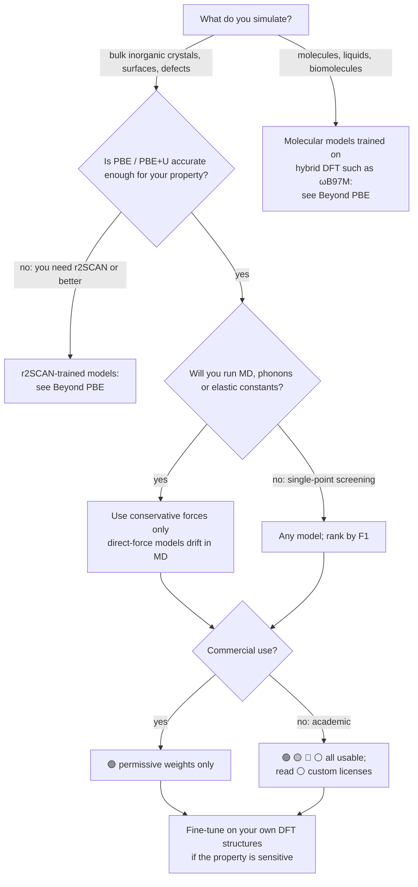

<!-- This file is generated by scripts/build.py from scripts/template.md. Edit those, not this. -->

# Foundation MLIPs: a practical guide

**Which pretrained machine-learned interatomic potential should you use, can you use it, and how do you load it?**

{{N_MODELS}} foundation models from {{N_FAMILIES}} families with benchmark scores, the data they learned from, force type, weight license and a working ASE snippet for each, on one page. The tables and figures are rebuilt every week from [Matbench Discovery]({{MBD_SITE}}).

[](https://github.com/NabKh/foundation-mlips/actions/workflows/update.yml)


[](https://github.com/NabKh/foundation-mlips/blob/main/LICENSE)

{{FIG_PARETO}}

**Contents:** [Choosing a model](#choosing-a-model) · [Leaderboard](#leaderboard) · [Trends](#trends) · [How to load each model](#how-to-load-each-model) · [Beyond PBE and bulk crystals](#beyond-pbe-and-bulk-crystals) · [Pitfalls](#pitfalls) · [Data sources](#data-sources-and-credit)

## Choosing a model



Three questions sort most choices:

1. **Level of theory.** Almost every model in the leaderboard learned PBE or PBE+U energies; the two marked *Various* use mixed collections that are mostly PBE(+U). A model reproduces its reference, including PBE's errors: band gaps are not predicted, and lattice constants, van der Waals binding and reaction barriers are PBE-quality. If PBE is the wrong reference for your problem, a better potential will not fix it.
2. **Force type.** *Conservative* models get forces as the gradient of the energy, so energy is conserved in MD. *Direct* models predict forces as a separate output; they are faster but do not conserve energy. In the leaderboard below every direct model has a phonon error κ<sub>SRME</sub> above 1.6. Most conservative models are below 0.7; the exceptions are the two oldest, CHGNet and M3GNet.
3. **License.** Code and weights often have different licenses, and the weights decide what you can do with the results. Several of the top models do not allow commercial use.

## Leaderboard

Active models with released weights, sorted by F1. The three best values in each column are in bold. Click a model name for its paper and a star count for its repository.

{{LEADERBOARD}}

**Columns**

- **Benchmarked**: the month the model was added to Matbench Discovery.
- **Training data**: the datasets, with their DFT level of theory underneath (from Matbench Discovery `data/datasets.yml`). *Various* means a mix of codes and functionals.
- **Forces**: *conservative* means forces are −∂E/∂r; **direct** means forces are a separate output.
- **F1 ↑**: harmonic mean of precision and recall for classifying the 257k WBM crystals as stable or unstable (energy above the MP convex hull ≤ 0). Range 0 to 1.
- **κ<sub>SRME</sub> ↓**: symmetric relative mean error of the phonon contributions to lattice thermal conductivity, averaged over 103 PhononDB-PBE materials. Range 0 to 2; it needs accurate second and third derivatives of the energy.
- **RMSD ↓**: normalised, unitless StructureMatcher RMSD between the ML-relaxed and the DFT-relaxed structure. Unmatched structures count as 1.0.
- **Weights license**: {{LICENSE_LEGEND}}

#### License corrections

Where a model's own repository disagrees with the license Matbench Discovery lists, this table uses the repository:

{{LICENSE_CORRECTIONS}}

## Trends

{{FIG_TIMELINE}}

Most of the gain since 2024 comes from training data. Every model trained only on MPtrj (1.58 M structures) scores F1 below 0.85. Models that add OMat24 and sAlex, much larger sets with many off-equilibrium structures, score 0.81 to 0.91 and fill the top ten.

{{FIG_SIZE}}

Among the models trained on MPtrj + OMat24 + sAlex, every one above 10 M parameters scores F1 0.86 to 0.91, whether it has 10 M (MatRIS) or 730 M (PET-OAM-XL) parameters. The colours, which mark the training data, separate more cleanly than the sizes do.

{{FIG_DATASETS}}

Almost every training set is PBE or PBE+U, as recorded in Matbench Discovery's dataset list.

## How to load each model

Every snippet below comes from the model's own README or documentation, linked under each one, and returns an ASE calculator. Run it in a clean environment per family, because the PyTorch, e3nn and JAX pins often conflict.

```python
from ase.build import bulk
from ase.filters import FrechetCellFilter
from ase.optimize import FIRE

atoms = bulk("Cu", "fcc", a=3.6, cubic=True)
atoms.calc = calc  # any calculator below
FIRE(FrechetCellFilter(atoms)).run(fmax=0.02)
print(atoms.get_potential_energy(), atoms.cell.lengths())
```

{{SNIPPETS}}

## Beyond PBE and bulk crystals

Matbench Discovery tests only PBE-level inorganic crystals. The models below are trained on other levels of theory or other chemistry, so they are not in the leaderboard and their scores cannot be compared with it.

{{BEYOND_PBE}}

## Pitfalls

1. **Energies are on different scales.** A model reproduces the energy reference of its training data, and those differ. MACE-MP models learned raw MPtrj VASP energies, without MP2020 corrections ([MACE README](https://github.com/ACEsuit/mace#pretrained-foundation-models)). CHGNet energies include the MP2020 corrections. Models trained on OMat24 use different DFT(+U) settings and are not compatible with Materials Project energies: do not apply MP2020 corrections to them or mix them with MP reference compounds ([fairchem README](https://github.com/facebookresearch/fairchem#readme)). Build convex hulls and reaction energies from one model, or check which reference the model uses before mixing in DFT values.
2. **Systematic softening.** M3GNet, CHGNet and MACE-MP-0 underestimate the curvature of the energy surface, because their training data are mostly near equilibrium: surface, defect and solid-solution energies, phonon frequencies and migration barriers come out too low. Fine-tuning on very little data corrects most of it; the authors show it with a single extra structure ([Deng et al., arXiv:2405.07105](https://arxiv.org/abs/2405.07105)).
3. **Direct forces in MD.** A direct-force model does not conserve energy, so an NVE run drifts and NVT hides the drift in the thermostat. Check the energy drift in a short NVE run before trusting any production MD.
4. **Benchmark scope.** F1 is measured on WBM, a set of bulk inorganic crystals. It says little about surfaces, interfaces, amorphous phases, liquids, molecules or high-pressure phases ([Riebesell et al., arXiv:2308.14920](https://arxiv.org/abs/2308.14920)).
5. **Magnetism and charge.** Unless a model's documentation says otherwise, assume it has no spin or charge input. It then learns whatever magnetic state the training DFT converged to, and cannot tell apart two magnetic orderings or two charge states of the same structure.
6. **Name the exact checkpoint.** Scores here are for the checkpoint Matbench Discovery tested, linked from each model's [`models/*.yml`](https://github.com/janosh/matbench-discovery/tree/main/models) file. Families ship several checkpoints with different scores, so report the file name in your paper.

## Data sources and credit

- Benchmark metrics, model metadata, training sets and licenses: [Matbench Discovery]({{MBD_URL}}) (MIT), commit {{MBD_COMMIT}}, Riebesell et al., *Nat. Mach. Intell.* (2025), [doi:10.1038/s42256-025-01055-1](https://doi.org/10.1038/s42256-025-01055-1). Every row links back to the paper; the raw values are in [`data/models.json`](data/models.json).
- Star counts: GitHub API.
- Loading snippets and the Beyond-PBE table: each model's own documentation, linked in place, curated in [`data/families.yaml`](data/families.yaml) and [`data/beyond_pbe.yaml`](data/beyond_pbe.yaml).
- License corrections: [`data/license_overrides.yaml`](data/license_overrides.yaml).

Last rebuilt {{UPDATED}}. Spot an error or a missing model? [Open an issue](https://github.com/NabKh/foundation-mlips/issues) or see [CONTRIBUTING.md](CONTRIBUTING.md). New benchmark results belong in Matbench Discovery; they appear here at the next weekly rebuild.

## Citing

If this guide helps your work, cite the benchmark and the models you use. To cite the guide itself, use [CITATION.cff](CITATION.cff).
